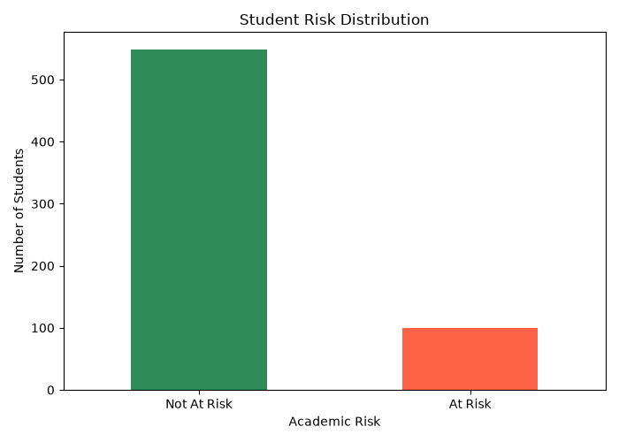
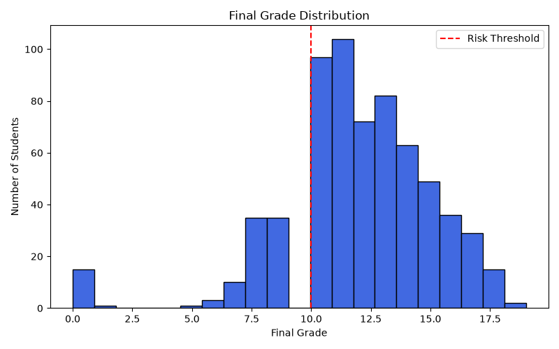
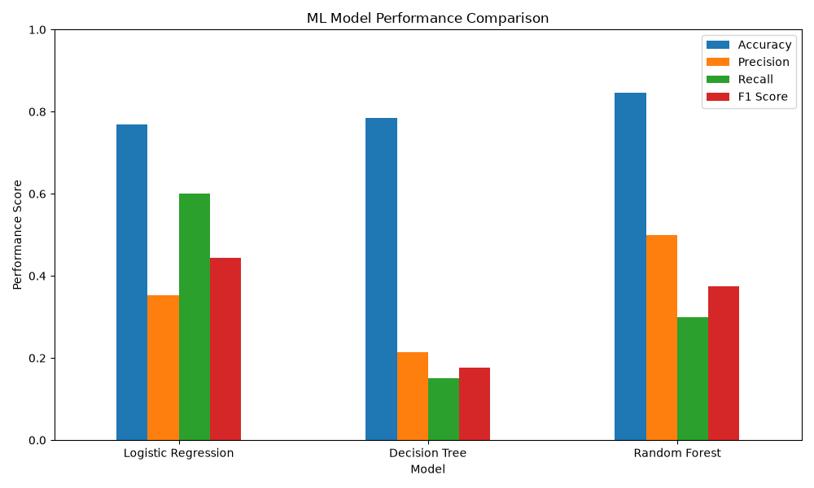
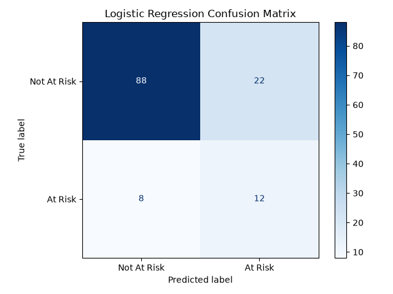

# 🎓 Early Warning System for Student Academic Performance

## 👨‍💻 Student Information

- **Name:** MD SK MUSTAKIM
- **Department:** CSE (AI & ML)
- **Institute:** Ghani Khan Choudhury Institute of Engineering and Technology (GKCIET), Malda
- **Subject:** Introduction to Machine Learning
- **Subject Code:** PCCAIML 502
- **Domain:** Machine Learning
- **Guided by:** Dr. Showmik Bhowmik

## 📌 Project Description

This project uses Machine Learning to identify students who may be at risk of poor academic performance.

An interactive Streamlit web application allows users to enter student information, predict academic risk, view model risk scores, and explore dataset analysis and model performance.

## 🎯 Project Objectives

- Identify academically at-risk students.
- Analyze student-related factors.
- Compare three Machine Learning algorithms.
- Support early academic intervention.
- Develop an interactive prediction application.

## 📂 Dataset

- Source: UCI Machine Learning Repository
- Dataset: Student Performance
- Total Records: 649
- At Risk (1): Final grade below 10
- Not At Risk (0): Final grade 10 or above

Dataset Link:
https://archive.ics.uci.edu/dataset/320/student+performance

## 🛠️ Technologies Used

- Python
- Pandas
- NumPy
- Matplotlib
- Scikit-learn
- Streamlit
- Joblib
- UCI ML Repository

## ⚙️ Methodology

1. Dataset collection
2. Data cleaning and preprocessing
3. Exploratory data analysis
4. Feature preparation
5. Training and testing split (80:20)
6. Machine Learning model training
7. Model evaluation and comparison
8. Interactive web application development

The final grade (G3) is excluded from input features to prevent target leakage.

## 🤖 Machine Learning Algorithms

1. Logistic Regression
2. Decision Tree
3. Random Forest

## 📊 Model Performance

| Model | Accuracy | Precision | Recall | F1 Score |
|---|---:|---:|---:|---:|
| Logistic Regression | 76.92% | 35.29% | 60.00% | 44.44% |
| Decision Tree | 78.46% | 21.43% | 15.00% | 17.65% |
| Random Forest | 84.62% | 50.00% | 30.00% | 37.50% |

### Selected Model: Logistic Regression

Although Random Forest achieved higher accuracy, Logistic Regression achieved the highest recall and F1 score in this experiment.

Since identifying academically at-risk students is the primary objective, Logistic Regression was selected for the prediction application.

## 📈 Exploratory Data Analysis

### Student Risk Distribution



### Final Grade Distribution



## 📉 Model Performance Comparison



## 🔍 Confusion Matrix



## 💻 Web Application Features

- Interactive student information form
- Academic risk prediction
- Model risk score
- Recommended academic support
- Dataset visualization
- Model performance comparison
- Confusion matrix visualization
- User-friendly dashboard

## 📁 Project Structure

```text
Student_Performance_Project/
├── main.py
├── app.py
├── requirements.txt
├── README.md
└── outputs/
    ├── student_risk_model.pkl
    ├── confusion_matrix.png
    ├── grade_distribution.png
    ├── risk_distribution.png
    ├── model_comparison.png
    └── model_results.csv
```

## 🚀 How to Run the Project

### Step 1: Clone the repository

```bash
git clone https://github.com/mdskmustakim/Student_Performance_Project.git
cd Student_Performance_Project
```

### Step 2: Install dependencies

```bash
pip install -r requirements.txt
```

### Step 3: Train the models and generate outputs

```bash
python main.py
```

Close any displayed graph windows to allow execution to finish.

### Step 4: Launch the web application

```bash
python -m streamlit run app.py
```

### Step 5: Open the application

http://localhost:8501

## 🌍 Real-World Applications

- Smart campus academic monitoring
- Early identification of struggling students
- Academic counseling and support
- Student performance monitoring

## ⚠️ Limitations and Future Scope

The selected model identified 12 out of 20 at-risk students in the test dataset.

The dataset may not represent students from every educational institution.

Model risk scores are not calibrated real-world probabilities. Predictions should not be used as final academic decisions.

Future improvements may include collecting local institutional data, improving model performance, and developing a secure student monitoring system.

## 🏁 Conclusion

This project demonstrates how Machine Learning can support early identification of academic risk.

The interactive Streamlit application provides a practical demonstration of student risk prediction, data analysis, and model evaluation.

## 🙏 Acknowledgement

I sincerely thank Dr. Showmik Bhowmik for his guidance and encouragement throughout this academic project.

Dataset credit: UCI Machine Learning Repository.

---

Developed by MD SK MUSTAKIM | CSE (AI & ML) | GKCIET | 2026
